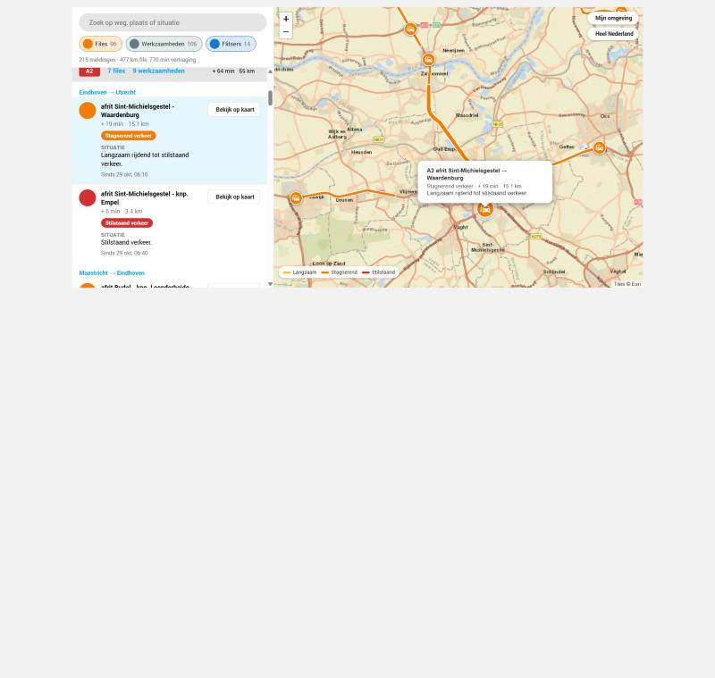
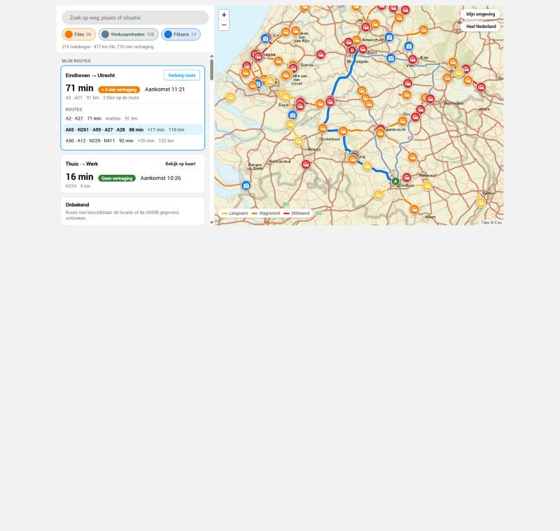
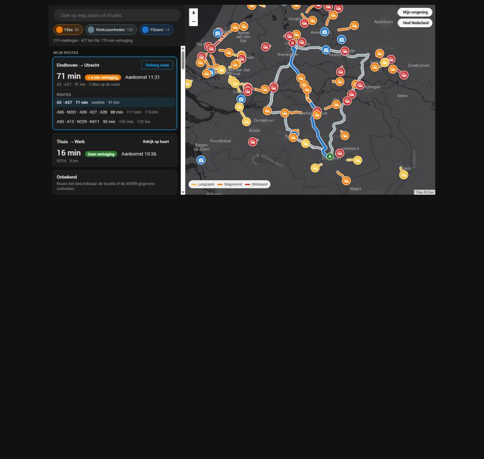

# ANWB File

[](https://github.com/hacs/integration)

[](https://my.home-assistant.io/redirect/hacs_repository/?owner=vinnie1234&repository=HomeAssisantANWBFile&category=integration)
[](https://my.home-assistant.io/redirect/config_flow_start/?domain=anwb_file)

Live traffic information from **ANWB**: traffic jams (files), speed cameras (flitsers) and roadworks, as sensors and as markers on the Home Assistant map.

## Screenshots

| | |
|---|---|
|  |  |
| *Jams per road, "Bekijk op kaart" zooms to an incident* | *A route with travel time, delay and alternatives* |



*Screenshots use live ANWB data in a test page; the layout in Home Assistant follows your theme.*

## Setup options

When adding the integration (and later via **Configure**) you choose:

| Option | Choices |
|---|---|
| Refresh interval | 1 - 60 minutes (default 5) |
| Road types | A roads only / A and N roads / all roads (incl. city ring roads) |
| Roads | All roads, or specific roads (pick from the list or type e.g. `A2`, `N201`) |
| Incidents | Traffic jams, speed cameras, roadworks and closures (default: jams and speed cameras) |
| Show on map | Which of those get a marker on the map (default: jams and speed cameras). The card list always shows everything you track |

Changing the options reloads the integration.

### Only specific roads

1. In the integration setup (or later **Settings → Devices & Services → ANWB File → Configure**) set **Roads** to *Specific roads*.
2. In the next step pick roads from the dropdown, which lists the roads that currently have a report, or type your own and press Enter, for example `A2`, `A12`, `N201`. Spaces and lower case are fine (`a 2` becomes `A2`).
3. The *Road types* setting decides which roads are offered: A roads only, A and N roads, or all roads. A road you type must match that type to show up.

With specific roads selected:
- only incidents on those roads are fetched, shown in the card, put on the map and counted in the sensors;
- you get an extra sensor per road, `sensor.anwb_file_traffic_jams_<road>` (for example `sensor.anwb_file_traffic_jams_a2`), with the number of jams on that road and `length_km`, `delay_min` and a `jams` list as attributes. Use it in automations such as "notify me when the A2 has a jam":

```yaml
triggers:
  - trigger: numeric_state
    entity_id: sensor.anwb_file_traffic_jams_a2
    above: 0
actions:
  - action: notify.notify
    data:
      message: "File op de A2: {{ state_attr('sensor.anwb_file_traffic_jams_a2', 'delay_min') }} min vertraging"
```

The per-road sensors are only created for roads you list, and only when jams are tracked.

### Automation examples for the A12

These work with *All roads* or with *Specific roads* that include `A12`. The attributes of the main sensors (`jams`, `roadworks`, `radars`) list every incident with `road`, `direction`, `from`, `to`, `reason`, `length_km`, `delay_min`, `start` and `stop`, so you can filter on any road yourself.

**Notify with details when a jam appears on the A12** (a template trigger fires when the condition turns true, so you get one message per new jam situation, not one per refresh):

```yaml
alias: "File op de A12"
triggers:
  - trigger: template
    value_template: >
      {{ state_attr('sensor.anwb_file_traffic_jams', 'jams')
         | selectattr('road', 'eq', 'A12') | list | count > 0 }}
actions:
  - action: notify.notify
    data:
      title: "File op de A12"
      message: >
        
        {{ jam.from }} → {{ jam.to }}: {{ jam.delay_min }} min, {{ jam.length_km }} km.
        {{ jam.reason }}
        
```

**Only when the delay is longer than 15 minutes** (total over all A12 jams):

```yaml
triggers:
  - trigger: template
    value_template: >
      {{ state_attr('sensor.anwb_file_traffic_jams', 'jams')
         | selectattr('road', 'eq', 'A12') | map(attribute='delay_min') | sum > 15 }}
```

**Speed camera on the A12** (needs *Speed cameras* tracked):

```yaml
triggers:
  - trigger: template
    value_template: >
      {{ state_attr('sensor.anwb_file_speed_cameras', 'radars')
         | selectattr('road', 'eq', 'A12') | list | count > 0 }}
actions:
  - action: notify.notify
    data:
      message: >
        Flitser op de A12:
        {{ (state_attr('sensor.anwb_file_speed_cameras', 'radars')
            | selectattr('road', 'eq', 'A12') | map(attribute='from') | list)[0] }}
```

**Roadworks or closures on the A12** work the same way, with `sensor.anwb_file_roadworks` and its `roadworks` attribute (needs *Roadworks* tracked). Use `start` and `stop` to see when it begins and ends.

Tip: you can test a template first under **Developer tools → Template**.

## Sensors

| Sensor | Description |
|---|---|
| `sensor.anwb_file_traffic_jams` | Number of jams, with a `jams` attribute listing them |
| `sensor.anwb_file_traffic_jam_length` | Total jam length (km) |
| `sensor.anwb_file_traffic_jam_delay` | Total delay (minutes) |
| `sensor.anwb_file_roadworks` | Number of roadworks / closures, with a `roadworks` attribute |
| `sensor.anwb_file_speed_cameras` | Number of speed cameras, with a `radars` attribute |
| `sensor.anwb_file_traffic_jams_<road>` | Only when specific roads are selected: jams per road |

Sensors only exist for the incident types you selected.

## Routes

Set up routes between two places and get the travel time, delay and arrival time of the fastest route with live traffic (ANWB route planner).

1. **Settings → Devices & Services → ANWB File → Configure → Add a route**
2. Give it a name, for example `Thuis → Werk`, and choose for the start and the end whether you give **a location** (pin on the map) or **a zone, person or device tracker**.
3. In the next two steps set the start and then the end. A tracked entity uses its live position, so a route "from my phone to home" always starts where you are.
4. Repeat for more routes. **Remove a route** is in the same menu. Routes refresh with the same interval as the incidents.

Each route becomes a device `ANWB Route <name>` with these sensors:

| Sensor | Description |
|---|---|
| `sensor.anwb_route_<name>_travel_time` | Travel time in minutes including traffic (attribute `normal_duration_min`: without delays) |
| `sensor.anwb_route_<name>_delay` | Delay in minutes caused by traffic |
| `sensor.anwb_route_<name>_arrival_time` | Expected arrival if you leave now (timestamp) |
| `sensor.anwb_route_<name>_distance` | Distance in km |
| `sensor.anwb_route_<name>_route` | The A and N roads of the fastest route. Attributes: `alternatives` (via, travel time, delay, distance, arrival and difference per alternative), `incidents`, `toll`, `origin`, `destination` |

The ANWB File card lists your routes at the top. **Bekijk op kaart** draws the fastest route in blue with the jams on that route in orange or red, plus the alternatives in grey. Click an alternative to draw that one instead.

Example, a notification when the way home takes much longer than usual:

```yaml
alias: "Vertraging op de route naar huis"
triggers:
  - trigger: numeric_state
    entity_id: sensor.anwb_route_werk_thuis_delay
    above: 10
conditions:
  - condition: time
    after: "15:30:00"
    before: "19:00:00"
actions:
  - action: notify.notify
    data:
      title: "File op de route naar huis"
      message: >
        {{ states('sensor.anwb_route_werk_thuis_delay') | int }} minuten vertraging.
        Aankomst om {{ as_timestamp(states('sensor.anwb_route_werk_thuis_arrival_time')) | timestamp_custom('%H:%M') }}.
```

Notes: the entity ids follow the route name you chose (check them under *Developer tools → States*). Routes are searched by coordinates, there is no address search yet.

## ANWB File card

A dashboard card that works like anwb.nl/verkeer: a list grouped per road next to a map.

Add it via **Add card** (it is listed under *Custom cards* as **ANWB File**, with a visual editor), or in YAML:

```yaml
type: custom:anwb-file-map-card
show_map: true  # false = list only, without the map (default true)
radius_km: 20   # initial map view: your Home Assistant location + this radius (default 20)
height: 640     # card height in px on wide screens (default 640)
```

- **List per road** with a road badge (A red, N yellow), number of jams / roadworks / speed cameras, total delay and length. Click a road to expand it: per direction you see the stretch, delay, length, the situation text and the period for roadworks.
- **Bekijk op kaart** zooms the map to that incident and opens its details.
- **Search** on road, place or situation text, and **filter chips** for jams, roadworks and speed cameras. The map follows the search and filters.
- **Map** with jams drawn as a coloured line along the road (yellow = slow, orange = queueing, red = stationary or closed) and a round icon marker per incident: car (jam), roadworker (roadworks), camera with signal waves (speed camera). The map starts zoomed on your Home Assistant location; buttons jump back there or to all of the Netherlands.
- Follows the light/dark theme and switches to a stacked layout on narrow screens.

The card is added automatically by the integration; if it is not found after setup, refresh the browser (Ctrl+F5). Which incidents are drawn on the map is set in the integration options (**Show on the map**). Incidents you track but do not put on the map stay in the list, and "Bekijk op kaart" still shows them.

## Standard Map card

When at least one category is set to show on the map, those incidents are also `geo_location` entities (source `anwb_file`) with a coloured icon badge, so Home Assistant's own Map card can show them too:

```yaml
type: map
geo_location_sources:
  - anwb_file
```

The map in the ANWB File card uses Esri basemap tiles (no API key needed) and a bundled copy of Leaflet (see `www/LEAFLET-LICENSE.txt`).

## Installation

1. HACS → three dots → **Custom repositories** → `https://github.com/vinnie1234/HomeAssisantANWBFile`, category **Integration**
2. Download **ANWB File** and restart Home Assistant
3. **Settings → Devices & Services → + Add Integration → ANWB File**

## Notes

- Data comes from the public ANWB incident feed (`api.anwb.nl/routing/v1/incidents/incidents-desktop`); it is an unofficial API and may change.
- Be considerate with the refresh interval; the feed updates roughly every minute.

## License

MIT
